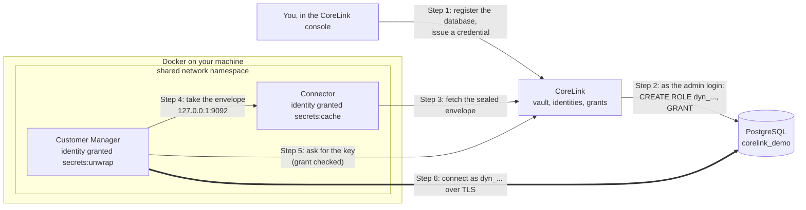
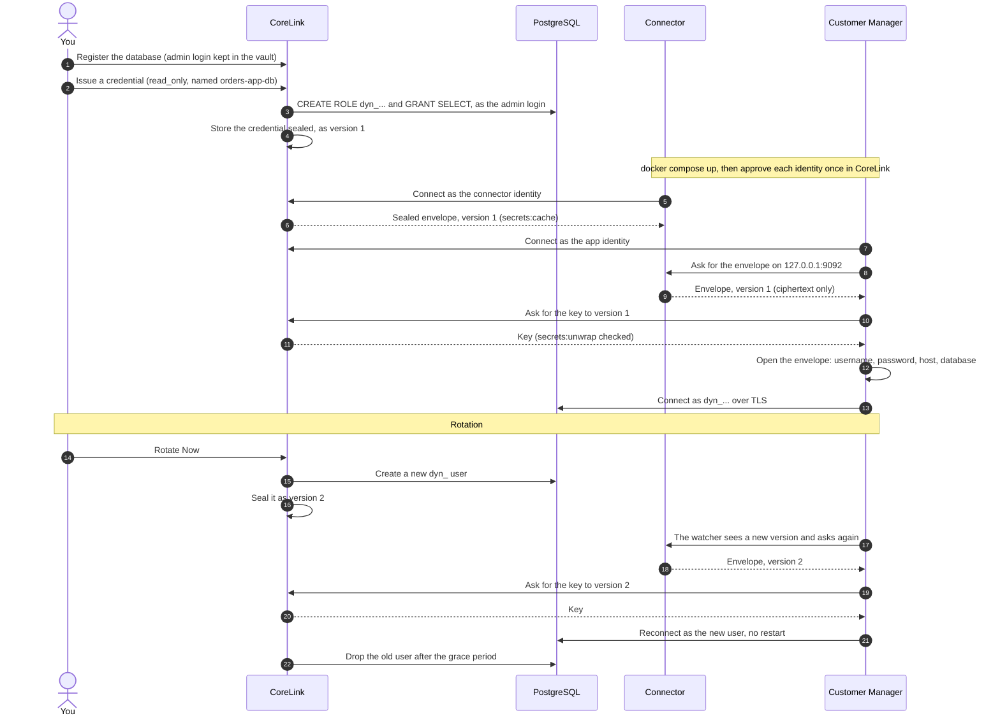

# CoreLink sample applications

Small, ordinary applications that use [CoreLink](https://usecorelink.com) for
their database credentials, so you can see how it works end to end on your own
machine.

## Customer Manager: dynamic database credentials

A customer list backed by PostgreSQL. There is no database password in its
configuration, its image or its environment. CoreLink creates a database
account for it, the app connects with that account, and when the credential
rotates the app reconnects on the new one without a restart.

### The pieces



The connector holds ciphertext and no key. The app gets the key only for the
one envelope its grant covers, and opens it in its own memory. The password
never passes through the connector in a readable form, and it is never written
to disk, an image or an environment variable.

### What happens, in order



The key for version 2 does not open version 1, and the reverse: each envelope
is bound to its own secret and version, so a replayed old envelope is refused.

### Who is allowed what

Two identities, each allowed one thing:

| Identity | Grant | What it can do |
|---|---|---|
| **connector** | `secrets:cache` on the credential | hold the sealed envelope, which it cannot open |
| **application** | `secrets:unwrap` on the credential | open that one envelope |

Neither has `secrets:read`, so neither can ask CoreLink for the password on its
own. The page shows both halves: the ciphertext the connector holds, and the
database user the app became after opening it.

### What you need

- A CoreLink account with access to **Dynamic Credentials**.
- A PostgreSQL server you can reach, and an admin login on it that can create
  users (`CREATEROLE`; a superuser is not required).
- Docker with Compose.

### 1. Load the demo database

```
PGSSLMODE=require psql -h <your-postgres-host> -U <admin-user> -d postgres \
  -v ON_ERROR_STOP=1 -f database/corelink_demo.sql
```

This creates a database called `corelink_demo` with customers, products,
orders and payments. **It drops and recreates `corelink_demo` if it exists.**
All data is made up.

Allow two sources in the database's firewall:

- **CoreLink's outbound addresses**, so it can create accounts. CoreLink lists
  them on the **Add Connection** page under *Allow these addresses in your
  database firewall*.
- **The public IP of the machine running this sample.** The app connects to the
  database directly, using the host in the credential.

### 2. Connect the database and issue a credential

In CoreLink:

1. **Dynamic Credentials > Add Connection.** Point it at your server and the
   `corelink_demo` database (not `postgres`), with the admin login. Press
   **Test Connection**, then save.
2. **Issue Credential** on that connection. Choose `read_only`, a lifetime, and
   a name such as `orders-app-db`. Note the name.

### 3. Create the two identities

First switch to the workspace that holds the credential: a new identity is
created in the workspace you have selected, and one in another workspace (or
tenant-wide) cannot see the credential and fetches nothing.

Then **Identity > NHI > New**, twice:

| Field | Connector | Application |
|---|---|---|
| Name | `customer-app-connector` | `customer-app` |
| Identity type | **Service Account** | **Service Account** |
| External ID | leave empty | leave empty |
| Owner | yourself | yourself |

Service Account is the type for a process you run yourself. The containers
prove who they are with a fingerprint of the host they run on, which CoreLink
checks whatever the type. Workload Identity is for cloud-managed identities and
is not needed here. Without an owner an identity is listed as orphaned.

On each identity's page, add one grant:

- `customer-app-connector`: **secrets / cache**, path set to the credential's
  name (`orders-app-db`).
- `customer-app`: **secrets / unwrap**, same path.

Copy each identity's ID from its page into `.env`.

### 4. Run it

```
cp .env.example .env
# fill in PLATFORM_URL, CONNECTOR_NHI_ID, APP_NHI_ID and SECRET_NAME
docker compose up --build
```

The first time each identity connects, it waits for a person to approve it.
Open the connector's identity page in CoreLink and **Approve** it, then do the
same for the app's. Approve them one at a time.

Then open **http://127.0.0.1:5051**.

### Things to try

- **Writes are refused.** Add a customer: a `read_only` credential gets
  "permission denied". Issue a `read_write` one, point `SECRET_NAME` at it,
  and run `docker compose up -d` again.
- **Rotation.** Open the credential's secret in CoreLink and press **Rotate
  Now**. Shortly after, the page shows a new dynamic user and a new envelope
  version, and the app keeps working: it reconnected on its own.
- **Revoke.** Revoke the credential in CoreLink. The database user is dropped,
  and nothing can connect as it again.
- **No grant, no secret.** Remove the app's `unwrap` grant and restart the app.
  It stops at startup and says which secret it could not get.

### Settings

| Variable | Required | Meaning |
|---|---|---|
| `PLATFORM_URL` | yes | Your CoreLink URL |
| `CONNECTOR_NHI_ID` | yes | The connector identity's ID |
| `APP_NHI_ID` | yes | The application identity's ID |
| `SECRET_NAME` | yes | The credential's name, exactly as shown in CoreLink |
| `CORELINK_VERSION` | no | Connector image version (default `1.28.89`) |
| `DB_SSLMODE` | no | Overrides the sslmode CoreLink issued (`disable`, `prefer`, `require`, `verify-full`) |
| `APP_PORT` | no | Local port for the page (default `5051`) |

The app uses the sslmode from the connection string CoreLink issues, which is
the SSL mode set on the connection. Managed databases such as Azure Database
for PostgreSQL require TLS, so leave that set to `require`.

### If it does not come up

```
docker compose logs connector
docker compose logs customer-app
```

- **Waiting for approval:** approve the identity on its page in CoreLink.
- **"no secret available to this identity":** the grant's path does not match
  `SECRET_NAME`, or the identity is in a different workspace from the
  credential.
- **The app keeps restarting after a secret was disabled:** nothing is
  delivered while a secret is disabled in CoreLink, so the app fails its
  startup check and Docker restarts it until the secret is enabled again.
- **The database connection times out:** the machine's public IP is not
  allowed in the database firewall.
- **"permissions would cover no tables" when issuing:** the connection points
  at the wrong database. It must be `corelink_demo`.

The page is published on `127.0.0.1` only. It shows the database user the app
is connected as and has no sign-in of its own, so do not expose it.
